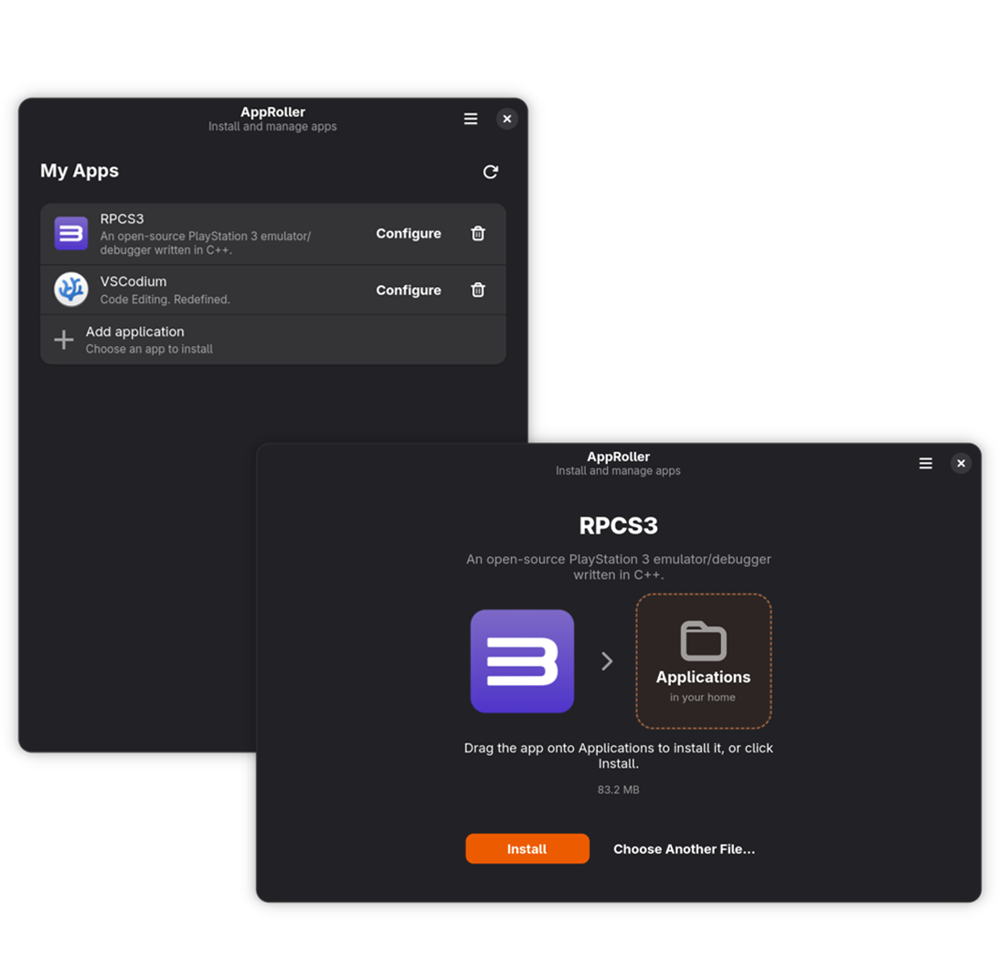

# AppRoller - APP IMAGE INSTALLER/MANAGER
AppRoller, the simple way to install Apps.

AppRoller is an App to install other Apps such as AppImages for creating desktop files and managing update's and version's for the user abstracting it into a singular app.

